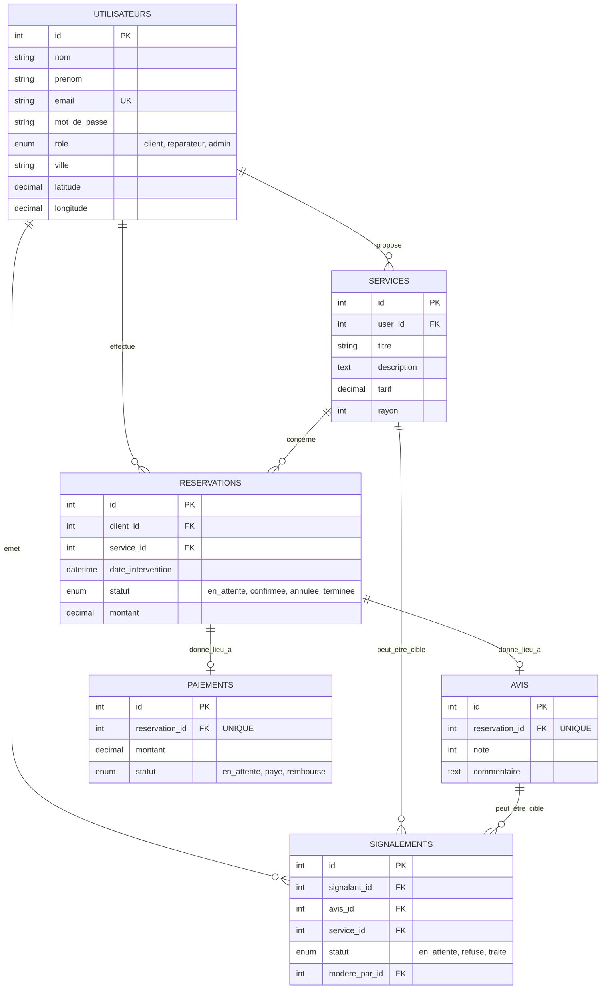
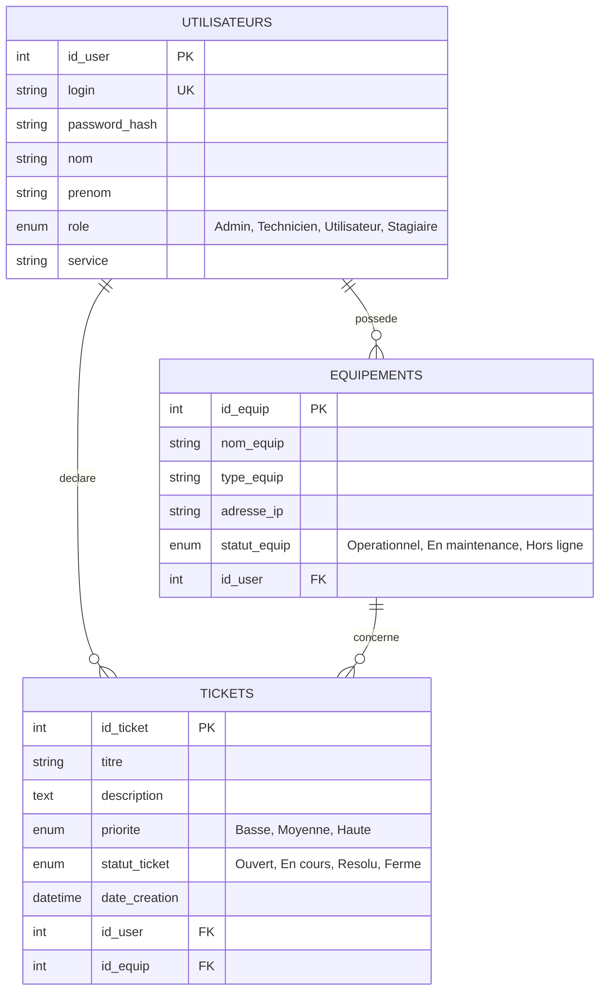

# Modèles de données — Fair’repair et GestioParc

Ces diagrammes servent de support à l’oral. Ils sont écrits en **Mermaid** :
GitHub et VS Code les affichent directement. Les scripts SQL complets sont dans
les dépôts des projets.

## Fair’repair — MCD simplifié

### Points à défendre

- `AVIS.reservation_id` et `PAIEMENTS.reservation_id` sont `UNIQUE` :
  **une réservation = un avis maximum, un paiement maximum**. La règle métier
  est portée par la base, pas seulement par le PHP.
- Toutes les tables sont en **InnoDB** avec clés étrangères.
- Les requêtes d’accès sont filtrées par `user_id` pour éviter les fuites entre
  comptes.

## GestioParc — MLD

### Points à défendre

- `EQUIPEMENTS.id_user` → `UTILISATEURS.id_user` avec `ON DELETE SET NULL` :
  supprimer un utilisateur ne doit pas supprimer le matériel.
- `TICKETS.id_equip` → `EQUIPEMENTS.id_equip` avec `ON DELETE SET NULL` :
  un ticket peut rester dans l’historique même si l’équipement est retiré.
- `TICKETS.id_user` → `UTILISATEURS.id_user` : le déclarant reste identifié.
- Le contrôle d’accès est appliqué dans les pages : un utilisateur ne voit que
  ses équipements et ses tickets ; l’admin voit tout.

## Ce que le jury peut demander

- La différence entre **MCD** (conceptuel, entités/relations) et **MLD**
  (tables, clés, types).
- Pourquoi une clé étrangère plutôt qu’un simple champ `user_id` sans contrainte.
- Ce qui se passe si on supprime un utilisateur qui a des tickets.
- Pourquoi une contrainte `UNIQUE` est plus fiable qu’un `if` en PHP.
- Où se trouve la sécurité : base, modèle, contrôleur, vue ?
